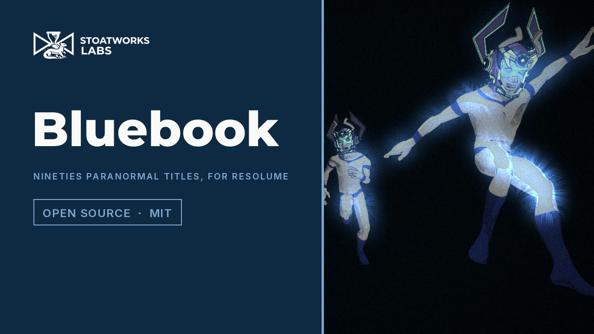

# bluebook

> **AI-assisted project.** This codebase was created with [Claude](https://claude.com/claude-code)
> (Anthropic), directed and reviewed by a human author. Its behaviour is measured rather
> than asserted: an offline harness drives the plugin's own class in a headless GL context
> and checks each claim against the picture. Prints land on the frame and the beat the
> model says, the smear rises as its half-life to a ULP, an enlargement magnifies by what
> it says to a quarter of a pixel, the aura falls off as a blurred edge does, the caption's
> capitals are the height asked for to the pixel, and a freeze holds the frame bit for bit.
> 13 negative controls and 17 one-character mutants prove the checks can fail. It loads and
> renders in **Resolume Arena** on a Mac and on Windows (software rendering), with every
> control as declared; in Arena on the Mac, Step On follows Arena's tempo and Freeze holds
> the frame. Nobody has played it in a show yet. The full rundown is under
> [Status](#status).

The look of a 1990s paranormal TV title sequence, and a crime-drama freeze-frame hit, as
an FFGL effect for [Resolume](https://resolume.com) Arena and Avenue.


<sub>One frame, rendered by `bbtest`, the offline harness, not captured from Resolume. The
harness's own test card (a figure, a light in the sky, a grid and colour bars) at 960×540,
150 frames in, on the defaults with Aura at 0.55, Corona at 0.7, the caption shown and Caption Y
at 0.2.</sub>

**[Try it in your browser](https://bluebook-demo.stoatworks-labs.com)**: the plugin's own GLSL
and caption font in WebGL2, unedited, fed by a JavaScript port of its CPU half (the print
clock, the freeze, the enlargement's generations, the torch, the caption's layout), every
control there, on a generated clip or one of your own. It's a demo rather than the plugin,
and the page says where the two differ. `demo/tools/check_port.mjs` holds the port to the
plugin: over 19 scenarios and 4,050 frames, 144,014 numbers compared with what the plugin's
own class decided, every integer equal and the worst double 2e-14 of its size apart.

<!-- downloads:start -->

## Download

**[v0.1.0](https://github.com/stoatworks-labs/bluebook/releases/tag/v0.1.0)** — prebuilt for macOS and Windows. Pick your platform:

<details>
<summary><b>macOS</b> — Universal (Apple Silicon + Intel)</summary>

| Build | Download | Size |
| --- | --- | --- |
| Universal (Apple Silicon + Intel) · .dmg disk image | [`bluebook-0.1.0-macos-universal.dmg`](https://github.com/stoatworks-labs/bluebook/releases/download/v0.1.0/bluebook-0.1.0-macos-universal.dmg) | 344 KB |
| Universal (Apple Silicon + Intel) · .zip archive | [`bluebook-macos-universal.zip`](https://github.com/stoatworks-labs/bluebook/releases/latest/download/bluebook-macos-universal.zip) | 292 KB |

</details>

<details>
<summary><b>Windows</b> — x64</summary>

| Build | Download | Size |
| --- | --- | --- |
| x64 · .exe installer | [`bluebook-0.1.0-windows-x86_64-setup.exe`](https://github.com/stoatworks-labs/bluebook/releases/download/v0.1.0/bluebook-0.1.0-windows-x86_64-setup.exe) | 268 KB |
| x64 · .zip archive | [`bluebook-windows-x86_64.zip`](https://github.com/stoatworks-labs/bluebook/releases/latest/download/bluebook-windows-x86_64.zip) | 172 KB |

</details>

All builds, checksums and release notes: [github.com/stoatworks-labs/bluebook/releases](https://github.com/stoatworks-labs/bluebook/releases).

macOS builds are signed and notarised and open normally. The Windows builds are unsigned, so SmartScreen warns once.

<!-- downloads:end -->

## Video

[](https://www.youtube.com/watch?v=9FP7gUHqJWM)

*[Watch it](https://www.youtube.com/watch?v=9FP7gUHqJWM), 77 seconds: the defaults and then
Step On on Beat, Enlarge four generations in, Stretch to three times, Aura round a dancer and
then Silhouette, the Torch sweeping, the caption spelling itself out as a Title and as a
Legend, Freeze on its own, and everything at once. Every frame is the plugin's own output,
rendered by `bbtest` over Resolume's demo clips and its own test card, not captured from
Resolume. It's silent, and Freeze's flash goes off three times.*

## The idea

If you watched television in the nineties you'll know the one I mean: thirty-odd seconds
of jittery, grainy footage that looked as if someone had smuggled it out of a filing
cabinet. The opening titles of The X-Files (1993) are a run of treatments rather than a
story (a stuttering print, a zoom into a photograph until it's all grain, a face pulled
long, a hand that glows, torches in the dark, a line of text spelling itself out) and
every one of them is something a VJ could use on any clip. So this plugin does the
treatments and leaves the footage to you. There's no footage, logo, music or lettering
from the show in here, and it isn't affiliated with anyone who made it.

It's named after Project Blue Book, the US Air Force's study of UFO reports from 1952 to
1969, which filed some twelve thousand sightings and concluded there was nothing to see.
Hence the default caption.

## What it does

Each group is a stage. Everything that belongs to one shot starts switched off; the
defaults are what the sequence did to every shot. They run in roughly this order, except that
the grade goes on before the torch and the glow (so a blue aura stays blue), the freeze catches
the print stage, and the caption goes over everything; the user guide's *One frame, in order*
has the exact order.

- **Print.** The clip, step-printed: a still every eighth of a second (or on the beat),
  held, with a short dissolve into the next one. Each print sits a hair off where the
  last one did, as film does in a tired gate. Trail smears the result, if you want the
  streaky version.
- **Enlarge.** The zoom into a photograph to find the thing in it. Each generation is a
  new enlargement of the last print, softer than the one before, and each carries the
  grain it was printed with, enlarged with it. Four generations in, the grain is coarse
  and clumpy and the picture is mostly guesswork, which is rather the point.
- **Stretch.** The face pulled long in a silent scream: a column of the picture drawn
  out vertically, pinched in at the waist, writhing a little.
- **Aura.** The glowing hand. Whatever is brightest (or darkest, or the clip's alpha)
  gets a glow round it, not on it, with streamers that run outwards from its edges.
  Silhouette darkens the subject itself, for the black shape against the light.
- **Torch.** A dark room with a beam crossing it, lit in linear light so the hot middle
  looks like a lamp and not a grey disc. It sweeps on its own or stays where you put it.
- **Film.** The grade: a cold teal duotone (or green, blue, amber, silver), crushed
  contrast, grain, an exposure that flickers frame by frame and a dark edge.
- **Caption.** A line of text revealed a letter at a time, in thin spaced capitals with
  a halo, centred as a title or right-aligned as an evidence legend with a catalogue
  number that moves on with every print.
- **Freeze.** The other show's hit. Press it and the frame on screen freezes with a white
  flash, drains to punchy black and white and pushes in slightly, then lets go after
  Freeze Hold, or stays until you press it again. Pressed again inside the hold, it hits
  on a new frame, so a pad on every beat gives a run of stills. It works on its own, with
  the rest switched off.

## Controls

| Group | |
| --- | --- |
| **Print** | Stutter (0 the live clip, 1 the prints), Step On (Rate, Beat, 1/2 Beat, 1/4 Beat, Bar), Step Rate (1–30 prints a second), Dissolve (the share of each print spent dissolving in), Weave (0–1.2 % of the frame height), Trail (a smear with a half-life of up to 1.5 s). |
| **Enlarge** | Enlarge (how many generations in), Enlarge Run (Manual, or Cycle: one generation per print, then back to the start), Magnify (1.5–24× at the last generation), Generations (1–8), Enlarge X, Enlarge Y (what it zooms towards). |
| **Stretch** | Stretch (1–5× down the centre of the column), Stretch Width (4–80 % of the frame height), Writhe, Stretch X, Stretch Y. |
| **Aura** | Aura, Aura Size (the glow's reach, 0.3–12 % of the frame height), Aura Key (Bright, Dark, Alpha), Aura Threshold, Aura Colour (Blue, White, Green, Red, Violet), Corona (the streamers), Silhouette. |
| **Torch** | Torch, Torch Size (4–80 % of the frame height), Torch Sweep (0 stands still, then 20 s to 0.5 s a pass), Torch Angle (0–360°), Torch X, Torch Y. |
| **Film** | Tint (Teal, Green, Blue, Amber, Silver, Natural), Tint Amount, Contrast, Grain, Grain Size (1–4 px at 1080 lines), Flicker, Vignette. |
| **Caption** | Caption (up to 48 characters of plain ASCII; anything else draws as `?`), Caption Show (0 hidden, 1 every letter in; between, part-revealed), Caption Style (Title, Legend), Caption Size (cap height, 1.5–15 % of the frame height), Caption Spacing, Caption Glow, Caption Y. |
| **Freeze** | Freeze (press), Freeze Hold (0.25–10 s, and at the top it latches until the next press), Freeze Fade (0–1.5 s to grey), Freeze Flash, Freeze Push (0–20 %). |
| **Output** | Mix. |

Caption Show is a slider so you can run the reveal from a clip's timeline, a MIDI fader
or Resolume's own envelopes; at 1 every letter is in.

## Status

**v0.1.0.** Measured offline on one Mac, and run in Resolume Arena on that Mac and on
Windows. There's a [user guide](https://stoatworks-labs.com/software/bluebook/guide/) and a
[browser demo](https://bluebook-demo.stoatworks-labs.com).

### Measured offline, on macOS

`tools/verify.sh` runs every picture check at **two rasters**, 640×360 and 320×180, and
again on **Apple's software renderer** at 320×180. What the checks establish:

| check | result |
| --- | --- |
| `--identity` | every stage off returns the clip to within a half-float ULP; everything on at Mix 0 returns it **bit for bit** |
| `--print` | at 7 prints a second, Dissolve 0 and 0.5: every one of 59 frames shows the print and the dissolve the model says |
| `--beat` | Step On Beat and Bar at 120 BPM print on the host's beat, 0 of 250 frames wrong |
| `--weave` | over 20 prints at Weave 1, the print never sits further off than 1.2 % of the frame height (plus the overscan), does move, and the clip's edge never shows |
| `--trail` | at Trail 0.4 and 1, a black-to-white step rises as 1 − 0.5^(t / half-life) to within one half-float ULP for eight half-lives, and crosses half way on the half-life's frame |
| `--enlarge` | Magnify 4, three generations of four: ×2.8284 measured against 4^0.75 = 2.8284, about the target |
| `--grain` | four generations in, the grain's variance is 5.0× the live grain's (one layer per generation plus the live one), and correlated over a distance the live grain isn't |
| `--stretch` | Stretch 2: the centre column's lines at twice their distance to half a pixel, and three widths across, where they were |
| `--aura` | a glow just past the subject's edge and not on it; from one Aura Size out to two it falls as a blurred edge does, to within 15 %, at two sizes; at Silhouette 1 the subject is black inside its glow |
| `--torch` | the beam centred on its aim to a pixel, round, hottest in the middle; outside it the room keeps 3 % of its light in linear light; Torch Angle 90 sweeps upwards and crosses its aim half a pass in |
| `--grade` | Tint maps two colours of the same luma to the same duotone; Contrast 1 is smoothstep; Vignette follows its curve to a ULP |
| `--lettering` | an H is Caption Size tall and centred on Caption Y, to the pixel; a Title's ink is centred across; half shown, the first letters are in and the last aren't; Show 0 draws nothing |
| `--freeze` | the frame before the press, held **bit for bit** in grey for Freeze Hold; let go on the frame; a second press inside the hold freezes the clip as it is then, bit for bit; the flash and the fade as stated; latched until the next press; Freeze Push 1 pushes in ×1.2 (×1.2001 and ×1.1998 at the two rasters) |
| `--resize`, `--transparency`, `--state` | a new raster starts clean from its first frame; clear stays clear except where the aura's light falls; the host's GL state comes back |
| `--offline` | 55 parameter names, none repeated, none over FFGL's 16 characters; every range ends where this README says; the caption's layout, with an accent, an emoji or a stray byte each drawn and measured as one `?` and the 48-character limit counted in characters |
| `--negative` | **13** deliberately wrong models, **13** caught |
| mutation | **17** one-character mutants of the shipped GLSL and C++, **17** caught |
| `tools/sweep.py` | all **50** controls it can move measurably change the picture |
| shaders | all 7 compile through `glslc`, not merely through Apple's driver |
| CI | on every push, GitHub's macOS runner builds it and runs the offline checks and every picture check on its software renderer; the Windows DLL is built and loaded as a host loads it (its name, ID and 55 parameters, Caption a text field) |

The software renderer earned its keep: it found three things the GPU never showed (a mip
level blended into a 1:1 read, `uv` landing a hair off the texel centres, and
`mix(a, b, 1.0)` that isn't `b`), and all three are fixed. AGENTS.md has the details.

### In Resolume Arena, on macOS

Arena 7.28.1 (rev 26535) on the same Mac, 2 November 2026, with the v0.1.0 release build in
Extra Effects: Bluebook as a layer effect, driven over Arena's REST API, with the
composition's 1920×1080 output read back as snapshots, about thirteen a second. Nobody sat at
it and nothing was played to anybody.

- Arena lists **SW Bluebook** (`BK01`) under Video Effects, and all 56 controls (Arena's
  Opacity and the plugin's 55) arrive with the name, order, type, range and default
  declared. Caption is a text field. Nothing from the plugin in Arena's log.
- **Mix 0 is identical to the effect bypassed**, to the bit: not one of 2,073,600 pixels
  differs.
- On a still, with Grain, Flicker and Weave off wherever they'd get in the way, **38 of the
  plugin's controls change Arena's output**. Grain Size is inconclusive, since the grain it
  sizes is new every frame, and Stutter does nothing to a still with the weave off, which is
  right: a still prints as itself.
- **Step On follows Arena's tempo.** Over Resolume's *IntoTheGlow_21*, with Stutter 1 and
  Dissolve 0, the picture holds exactly between prints, and the prints came every 0.505 s on
  Beat at 120 BPM, every 2.01 s on Bar at 120 and every 2.43 s on Bar at 100 (medians, from
  snapshots about 0.07 s apart). Over *Galactucity_21*, Beat at 90 BPM printed every 0.659 s
  and 1/2 Beat at 60 every 0.512 s. Printing at Arena's tempo on the plugin's own clock would
  give the same numbers, so whether the prints come from Arena's bar phase, and land on its
  downbeat, isn't established.
- **Freeze**, pressed over REST at the defaults: the flash, no colour left by 0.39 s, the
  frame held unchanged, and the clip back between 1.30 and 1.39 s after the press, against
  Freeze Hold's 1.31 s.
- **Freeze and Bypass:** bypass the effect in the middle of a freeze and Arena shows the
  live clip; switch it back on and the grey frozen frame is still there. The time it spent
  bypassed counts for no more than a quarter of a second (the most the plugin's clock moves
  in one frame), so the hold runs on: a half-second bypass let go at about 1.7 s, not 1.35.
- **Save, new, open:** a Caption of `EXHIBIT 7` is in the saved composition, comes back as
  the Caption, and draws the same picture.

Not tried: Avenue, Bluebook as a clip effect, Arena's Opacity against a freeze, how the
inspector lays out the groups (the REST API doesn't show them), what it costs per frame
inside Arena, and quitting Arena with it loaded. Arena didn't act on the scripted quit and
was stopped with a signal, so nothing was unloaded at the end.

### In Resolume Arena, on Windows

The fleet's Arena gate (`arena/` in plugin-bench) ran a CI build of the Windows DLL in
**Resolume Arena 7.27.1** on win-lab, a Windows VM with no GPU (Mesa's llvmpipe). The DLL
loads and registers as `SW Bluebook`, `BK01`, an effect; every control (Arena's Opacity and
the plugin's own) arrives with the name, order, type, range and default declared; it
renders; Arena's log stays clean and Arena survived the run: **9 passed, 0 failed, 1
skipped**.

Against Arena's still test picture, 38 of the plugin's controls measurably changed the
frame, every Enlarge, Stretch and Aura control among them, and none came out dead. The
defaults' own grain, flicker and weave make every grab of a still a little different, so
the controls whose change is small were measured with those three switched off. Two were
still inconclusive: Torch Angle steers a beam that's already moving, and Grain Size sizes
grain that's new every frame, so neither keeps still long enough for two grabs to agree.
Eight can't act on a still at all and weren't asked to: Step On, Step Rate and Dissolve (a
still prints as the same still every time), Trail (a still smeared into itself is the
still it was) and the four Freeze settings (they only act during a freeze, and the gate
writes values and grabs stills). Step On and Freeze were tried in Arena on the Mac, not
here, and software rendering says nothing about a GPU, or about speed.

### Cost

Wall-clock time a frame by the harness, 60 frames after ten to warm up, with everything on
at once (Aura, Enlarge, Stretch, Torch, the caption and Trail) on the harness's card:
**0.32 ms** at 720p, **0.55 ms** at 1080p and **2.04 ms** at 4K, on an Apple Silicon Mac
with a GPU shared with other work. macOS figures only; nothing was timed in Resolume.

### Not established

**Nobody has played it in a show.** Everything under *Measured offline* was measured
against the plugin's own class in a headless CGL context, and everything in Arena was
driven over its REST API, so nobody has looked at how the inspector lays out the 55
controls, tried it in Avenue or as a clip effect, or seen how Arena's Opacity sits with
Freeze. Step On printed at Arena's tempo, but whether it reads Arena's bar phase and
lands on the downbeat isn't known. There's no preset dropdown (Resolume saves parameter
presets itself); the user guide's Recipes are the looks.

The harness's test card is drawn, not filmed, so how the Aura key copes with real
footage (where a bright sky is as "bright" as a hand) is a matter of setting Aura Key
and Aura Threshold to taste, and I haven't tried it on much.

## Build

macOS (universal: Apple Silicon and Intel):

```bash
git clone --recurse-submodules https://github.com/stoatworks-labs/bluebook
```

```bash
cmake -B build -DCMAKE_BUILD_TYPE=Release
```

```bash
cmake --build build
```

```bash
cmake --install build
```

The last one copies `Bluebook.bundle` into `~/Documents/Resolume Arena/Extra Effects`.
Restart Arena and it's under Effects as **SW Bluebook**.

Windows needs Visual Studio 2022 and vcpkg (for GLEW); see `.github/workflows/ci.yml`.

## Building and testing

```bash
tools/verify.sh
```

That's the whole lot: a fresh universal build, every check at two rasters and on the
software renderer, the negative controls, the mutants, the sweep for dead controls, the
bundle's architecture and plist, an ad-hoc signature, a host's view of it through
`oxbow` if you have it, and the render cost. `CLAUDE.md` lists the checks one by one.

Render a frame of your own:

```bash
./build/bbtest --out /tmp/bluebook.png --set Aura=0.6 --set "Caption Show=1" --caption "EXHIBIT 7: A SMUDGE"
```

## License

MIT. See [LICENSE](LICENSE) and [ATTRIBUTIONS.md](ATTRIBUTIONS.md).

<!-- attributions:start -->
This project is built on other people's work — see [ATTRIBUTIONS.md](ATTRIBUTIONS.md).
<!-- attributions:end -->
